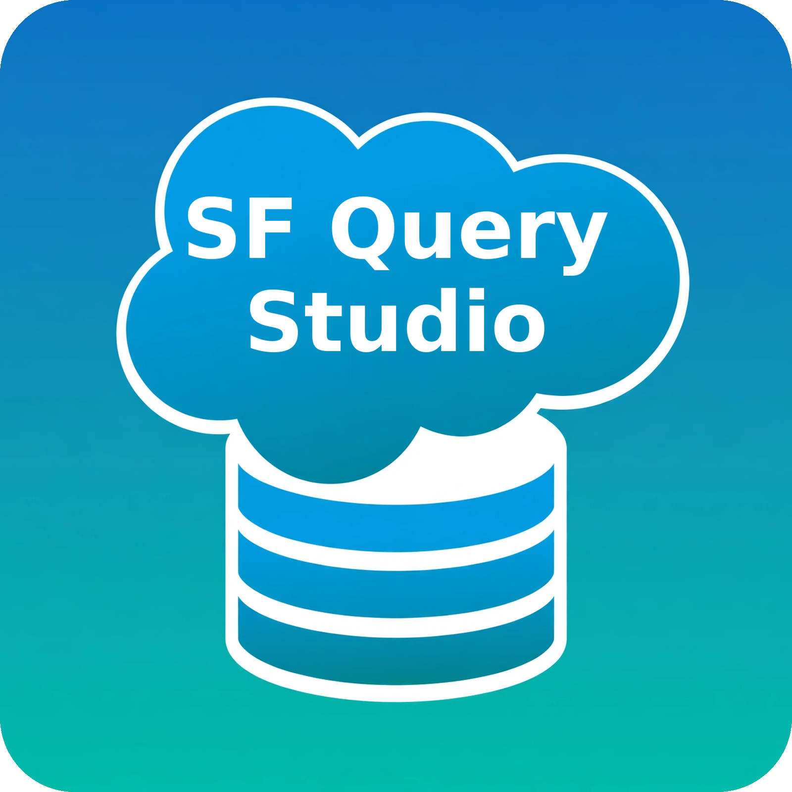

# Salesforce Query Studio



A Streamlit-based Salesforce toolkit for running SOQL queries, exploring object metadata, and managing records directly from your browser.

<!-- Badges -->
[](https://www.python.org/)
[](https://sf-query-studio.streamlit.app/)

## Overview

This app provides a clean, dark-themed interface for:

- Connecting to a Salesforce org using an External Client App's Client ID and Client Secret (OAuth 2.0 Client Credentials flow).
- Running ad hoc `SELECT` SOQL queries and viewing results in an interactive table.
- Using the new “Ask in Plain English” helper to turn natural-language requests into SOQL queries.
- Chatting with a read-only Salesforce assistant that answers questions about your connected org and about Salesforce in general.
- Downloading query results as CSV.
- Loading Salesforce records for inline editing, insert, update, and delete operations.
- Exploring Salesforce object metadata, field counts, relationships, picklists, and field type distributions.
- Managing custom objects and fields, including new Field-Level Security (FLS) support for assigning profile-based read and edit access.

## Features

### 1. Salesforce Connection

Found under the `Configuration` page:

- Choose between `Production` and `Sandbox` environments.
- Paste the External Client App's **Client ID** (Consumer Key) and **Client Secret** (Consumer Secret).
- Optionally override the login host with your My Domain.
- Connect and display the Run As user, profile, instance URL, and troubleshooting hints.

Authentication uses the OAuth 2.0 Client Credentials flow against
`/services/oauth2/token`. The legacy SOAP `login()` endpoint is retired for
API 31.0–64.0 (already unavailable from 65.0), so username/password/security
token auth is no longer supported. In the External Client App's OAuth settings,
enable **Client Credentials Flow** and assign a **Run As** user with the
**API Enabled** permission. Because this flow issues no refresh token, the app
requests a new access token automatically when the old one expires.

### 2. SOQL Query Editor

Found under the `SF SOQL Editor` page:

- Write any valid `SELECT` SOQL query.
- Use the new “Ask in Plain English” feature to describe the data you want in plain language and generate or refine a SOQL query.
- Execute the query and show response data in a sortable Streamlit table.
- Support for relationship fields and child relationship expansion in query results.
- Download query results as a CSV file.

### 3. Inline Record Editor

Also on the `SF SOQL Editor` page:

- Select a Salesforce object and choose fields to display.
- Load records using an optional `WHERE` clause.
- Edit returned records directly in a spreadsheet-like editor.
- Insert new rows, update modified rows, and delete checked rows.
- Automatically detect real changes to avoid unnecessary updates.

### 4. Bulkification

Also on the `SF SOQL Editor` page:

- Perform bulk record operations in the SOQL editor using Salesforce-compliant batch logic.
- Select multiple records and apply insert, update, or delete actions together.
- Reduce API round trips and improve throughput for large data changes.
- View bulk operation progress and error feedback directly in the app.

### 5. Field Analysis

Found under the `Field Analysis` page:

- Analyze any Salesforce object metadata.
- Show total field counts, custom fields, required fields, relationships, and child relations.
- Display field type distributions with Plotly charts.
- Browse detailed field rows with labels, types, lookup relationships, and custom field flags.
- Inspect picklist values for picklist and multipicklist fields.

### 6. Object Manager

Found under the `Object Manager` page:

- Create new custom objects and define custom fields (Text, Number, Picklist, etc.) using the Metadata API.
- Modify or delete existing custom fields on any object.
- Apply Field-Level Security (FLS) when creating or updating fields, including profile-based read and edit permissions.
- Set default FLS behavior for newly created fields to streamline field rollout across profiles.
- Browse all available Salesforce objects in the connected org.
- View object labels, API names, field counts, and record counts at a glance.
- Search and filter objects for faster navigation.
- Expand object details to inspect schema metadata and relationship summaries.

### 7. Session Information

Found under the `Session Information` page:

- Display the current Salesforce connection status and org details.
- Show the active username, instance URL, and API version in use.
- Provide helpful connection diagnostics for troubleshooting login issues.
- Allow users to verify whether the app is connected to Production or Sandbox.
- Useful for verifying that the app is connected to the correct Salesforce org before performing operations.

### 8. Salesforce Chatbot

Found under the `SF Chatbot` page:

- Ask plain-English questions about the org you are currently connected to, answered with live read-only SOQL run through your own Salesforce session.
- Ask general Salesforce questions — platform concepts, admin and developer how-to, terminology, SOQL and Apex syntax — answered directly without touching your org.
- Ask how any SF Query Studio page works, including access modes and what each page can and cannot do.
- Inspect every answer: an expandable "SOQL evidence" panel shows the exact query that was run, the records it returned, and whether a `LIMIT` was applied automatically.
- See an "Actions" trail under each answer listing the metadata lookups and queries used to build it.

Design constraints worth knowing:

- **Read-only, always.** The assistant can only run `SELECT` queries. Statements that attempt DML (`INSERT`, `UPDATE`, `DELETE`), stacked statements, and row-locking clauses such as `FOR UPDATE` are rejected before Salesforce is contacted. This holds even in Admin mode — the assistant will explain how to make a change and point you at the SOQL Editor or Object Manager, but never performs one.
- **Scoped to Salesforce.** Questions unrelated to Salesforce or this app are declined.
- **Session-bound.** The conversation lives only in your browser session. It is cleared automatically when you disconnect, reconnect, or connect as a different user, so one user's questions and results are never visible to the next.
- **Bounded reads.** A query without a `LIMIT` automatically receives `LIMIT 100`, so a broad question cannot page through an entire object.
- Requires an LLM API key (Gemini free tier or OpenAI) — see [AI Feature Configuration](#ai-feature-configuration).

### 9. Governor Limits

Found under the `Governor Limits` page:

- Shows live governor-limit consumption for the connected org, pulled from the Salesforce Limits REST API with per-session caching.
- KPI tiles for the key limits with ok / warning / critical status colors, rendered for both light and dark themes.
- A "Key Limits" section plus a full "All Limits" list with usage bars for every limit the org reports.
- Warns automatically when any limit is already past 70% of its quota.
- "Refresh now" button and an optional 30-second auto-refresh toggle; refreshing this page never wipes the other pages' caches.
- Read-only and informational — it never touches your org's data or metadata.

### 10. SF Cloud Code

Found under the `SF Cloud Code` page:

- A browser-based code workspace for Apex classes, Apex triggers, and Lightning Web Component bundles, with an Ace code editor, Git-style change indicators, and diffs against the server copy.
- Deploy to the org via the Tooling API (container flow) with a Metadata API fallback that preserves the deploy status.
- **Triggers:** pick the trigger's object straight from the org (REST global describe, triggerable objects only including custom `__c` objects; API names only; type or refresh to narrow the list), and deploy triggers as Active.
- **LWC:** new or partial bundles deploy as one atomic Metadata API zip (package.xml plus every bundle file, using the apiVersion from the bundle's own `.js-meta.xml`); pure updates go through Tooling PATCH.
- **Deleted-from-org detection:** if Refetch returns a 404, the file is flagged DELETED (🗑️ D) with a local-copy-intact warning and the stale server timestamp hidden; Deploy then recreates it and adopts the new Id (fully for Apex/triggers; a deleted LWC file is recreated into its existing bundle).
- **Persistent deploy feedback:** errors and warnings stay on screen across reruns until the next action on that file, a successful deploy, or the file is closed; success toasts show once, for their full duration.
- **Clean error messages:** `Compilation Failure …` envelopes are unwrapped into plain words with the exact line/column plus kind-specific hints, and failed Apex/Trigger creates show labeled detail ("Creating ApexClass was rejected:") that reads just like a failed update.
- Editing and deploying code requires Admin mode.

## AI Feature Configuration

Two pages use an LLM and need an API key: the “Ask in Plain English” helper on the `SF SOQL Editor` page, and the `SF Chatbot` page. Every other feature works without one.

Two providers are supported, switched with `LLM_PROVIDER` (`openai` is the default):

- **Gemini (free):** get a key at <https://aistudio.google.com/apikey> — no credit card needed. Set `LLM_PROVIDER=gemini`.
- **OpenAI (paid):** the original provider. Omit `LLM_PROVIDER` or set it to `openai`.

Create `.streamlit/secrets.toml` in the repository root:

```toml
# Free option — recommended
LLM_PROVIDER = "gemini"
GEMINI_API_KEY = "<your-gemini-key>"

# Paid option — uncomment to use OpenAI instead
# LLM_PROVIDER = "openai"
# OPENAI_API_KEY = "sk-your-key-here"

# Optional: override the model for either provider
# LLM_MODEL = "gemini-3.5-flash-lite"
```

Alternatively, set them as environment variables:

```bash
export LLM_PROVIDER="gemini"               # macOS / Linux
export GEMINI_API_KEY="<your-gemini-key>"
$env:LLM_PROVIDER = "gemini"               # Windows PowerShell
$env:GEMINI_API_KEY = "<your-gemini-key>"
```

Without a key for the active provider, the `SF Chatbot` page shows a configuration notice and disables its input rather than failing at runtime.

> **Important:** `.streamlit/secrets.toml` is listed in `.gitignore`. Keep it that way — never commit an API key.

### What is sent to the AI provider

Be deliberate about this before pointing the AI features at a Production org:

- **Sent:** your question, the recent conversation turns, your Salesforce username, your profile name, the org instance hostname, and **the records and field metadata returned by the queries the assistant runs**. If your org holds personal or regulated data, that data may leave your infrastructure.
- **Never sent:** your Salesforce Client Secret or API access token. The assistant's own Salesforce access is confined to your existing session.

If this matters for your organization, review your provider's data-retention terms (OpenAI's DPA/zero-retention options, or Google's Gemini API terms) before use, or run the AI features against a sandbox with non-sensitive data.

## Repository Structure

The project is organized around a main app entry point, a small set of shared utilities, and a multi-page Streamlit interface:

- `Home.py` - Main Streamlit entry point, homepage layout, and overall app styling.
- `permissions.py` - Shared helpers for loading Salesforce profile permissions, applying read-only safeguards, and controlling access to admin-level features.
- `pages/1_⚙️_Configuration.py` - Connection setup page for authenticating to Salesforce and selecting the environment.
- `pages/2_📝_SF_SOQL_Editor.py` - SOQL editor for running queries, viewing results, and managing records inline.
- `pages/3_📊_Field_Analysis.py` - Metadata explorer for analyzing fields, relationships, picklists, and field type distributions.
- `pages/4_📦_Object_Manager.py` - Object and field management experience for creating, editing, and configuring custom metadata.
- `pages/5_👤_Session_Info.py` - Session diagnostics page showing the active connection details and org information.
- `pages/6_🤖_SF_Chatbot.py` - Read-only Salesforce assistant that answers questions about the connected org and about Salesforce, with SOQL evidence for every answer.
- `pages/7_📈_Governor_Limits.py` - Live governor-limit consumption dashboard with KPI tiles, usage bars, and 70%-of-quota warnings.
- `pages/8_🌩️_SF_Cloud_Code.py` - Browser code workspace for Apex classes, triggers, and LWC bundles with deploy-to-org support.
- `cloud_code.py` - Shared backend for `SF Cloud Code`: Tooling API deploys, Metadata API fallback, trigger and LWC bundle handling, and clean error translation.
- `configuration.py` - OAuth 2.0 Client Credentials authentication: exchanges the External Client App's Client ID and Client Secret for an access token and refreshes it automatically when it expires.
- `requirements.txt` - Python dependencies required to run the app.
- `.gitignore` - Lists files and folders that Git should ignore, such as virtual environments, local secrets, and editor-specific artifacts.
- `LICENSE` - Contains the open-source license terms for the project.
- `README.md` - Provides project overview, setup instructions, usage guidance, and feature documentation.

## Dependencies

The app relies on the following packages:

- `streamlit`
- `pandas`
- `simple-salesforce`
- `plotly`
- `requests`
- `zeep`
- `openai` - used by the “Ask in Plain English” helper and the `SF Chatbot` page
- `streamlit-ace` - code editor used by the `SF Cloud Code` page

Python 3.10 or newer is required.

## Installation

1. Create a Python virtual environment:

```bash
python -m venv .venv
```

2.Activate the virtual environment:

Windows PowerShell:

```powershell
.\.venv\Scripts\Activate.ps1
```

3.Install dependencies:

```bash
pip install -r requirements.txt
```

## Running the App

From the repository root, run:

```bash
streamlit run Home.py
```

Then open the URL shown in your browser (usually `http://localhost:8501`).

## Creating an External Client App

SF Query Studio authenticates with an **External Client App** using the OAuth
2.0 Client Credentials flow. You create the app once per org, then copy two
values — the **Client ID** and **Client Secret** — into the Configuration page.

You need a user with permission to create and manage External Client Apps —
in most orgs that means **System Administrator**, or a profile with
**Customize Application** / **Manage Connected Apps**.

### Step 1 — Create the app

1. In Salesforce, open **Setup** (⚙️ → Setup).
2. In Quick Find, search for **External Client Apps** and open
   **External Client Apps** under *Apps*.
3. Click **New External Client App**.
4. Fill in the basics:
   - **External Client App Name** — e.g. `SF Query Studio`.
   - **Contact Email** — an address Salesforce can reach about the app.
   - **Distribution State** — `Local` is fine for a private/internal app.
5. Under **API (Enable OAuth Settings)**, check **Enable OAuth**.
6. Add the **Callback URL**. Client Credentials doesn't redirect anywhere, but
   Salesforce still requires a value — any HTTPS URL you control works, e.g.
   `https://localhost/callback`.
7. Add the OAuth scope **Manage user data via APIs (`api`)**. This is the scope
   SF Query Studio uses for REST, Bulk, Metadata, and Tooling calls.
8. Save the app.

### Step 2 — Enable the Client Credentials flow

This is the step that matters most — without it, the token request fails with
`invalid_grant` or `unsupported_grant_type`.

1. Reopen the External Client App you just created.
2. Go to **OAuth Settings** (or **Policies** → *OAuth Flows and External Client
   App Enhancements*, depending on your org's UI).
3. Under **Flow Enablement**, check **Enable Client Credentials Flow**.
4. Set **Run As (Username)** to the user the app should act as.
   - This user is who every token is issued for. Their profile and permissions
     decide what the app can read and write.
   - They must be **active** and have the **API Enabled** system permission.
   - Least privilege applies: use a dedicated integration user rather than an
     admin if your use case allows it. If you need Object Manager features
     (creating objects and fields), the Run As user needs **Customize
     Application** and/or **Modify All Data**.
5. Check **Permitted Users**. For Client Credentials, `All users may
   self-authorize` is the usual choice; the Run As assignment above is what
   actually controls which identity issues tokens.
6. Save.

### Recommended setting values (Step 2)

Exactly two settings change what SF Query Studio can do: **Enable Client
Credentials Flow** and **Run As**. Everything else in the OAuth panel can keep
its default. The table below lists each option so you don't have to guess.

| Setting | Recommended | Why |
| --- | --- | --- |
| **Enable Client Credentials Flow** | ✅ Checked (**required**) | The only grant SF Query Studio uses. Leave unchecked and the token request fails with `invalid_grant` / `unsupported_grant_type`. |
| **Run As (Username)** | Set (**required**) | Decides the identity every token belongs to. Must be active and have **API Enabled**. |
| **Permitted Users** — `All users may self-authorize` | Safe | The Run As user, not this policy, decides which identity issues tokens. |
| **Permitted Users** — `Admin approved users are pre-authorized` | Also safe | Stricter. You must add a profile or permission set under **Manage Profiles** / **Manage Permission Sets**; the Run As user must be included. |
| **Enable Authorization Code and Credentials Flow** | Leave as-is | Not used. Harmless if checked. |
| **Require user credentials in the POST body for Authorization Code and Credentials Flow** | Leave as-is | Only affects authorization code requests. |
| **Enable Device Flow** | Leave unchecked | Not used by this app. |
| **Enable JWT Bearer Flow** | Leave unchecked | Not used. Requires a certificate and a different signing setup. |
| **Enable Token Exchange Flow** | Leave unchecked | Not used by this app. |
| **Require secret for Web Server Flow** | Leave as-is | Authorization code only. |
| **Require secret for Refresh Token Flow** | ✅ Checked (safe default) | No refresh token is ever issued for this flow, so it has no effect. Checked stays correct if the app later adds an authorization code flow. |
| **Require Proof Key for Code Exchange (PKCE) extension for Supported Authorization Flows** | Leave as-is | Authorization code only. |
| **Enable Refresh Token Rotation** | Leave as-is | No refresh tokens are issued here. |
| **Issue JSON Web Token (JWT)-based access tokens for named users** | Leave unchecked | The app expects a standard opaque bearer token. |
| **Limit Idle Refresh Token Time-to-live (TTL) to 30 Days** | Leave as-is | Salesforce-required; unrelated to refresh tokens here. |
| **OAuth Start URL** | Leave blank | Only used for interactive flows. |
| **Custom Scopes** | Leave empty | The standard `api` scope is enough. |
| **Apex Plugin Class** | Leave empty | Not needed. |

**Required OAuth scope:** `Manage user data via APIs (api)`. The
`refresh_token` / `offline_access` scope (shown as *"Perform requests at any
time"*) is **not** required. Client Credentials never returns a refresh token,
so that scope grants nothing this app can use — but leaving it enabled is
harmless and won't break the connection. SF Query Studio doesn't send a
`scope` parameter in its token request, so configured scopes don't affect the
grant; add only what you actually need for least privilege.

### Step 3 — Copy the Client ID and Client Secret

1. In the External Client App, open **OAuth Settings** →
   **App Credentials** (or the **Client Credentials** section, depending on UI).
2. Copy the **Client ID** (Consumer Key). It starts with `3MVG9…`.
3. Reveal and copy the **Client Secret** (Consumer Secret).

> ⚠️ Treat the Client Secret like a password. Don't commit it to source
> control, paste it into chat, or put it in a screenshot. If it's exposed,
> use **Rotate Consumer Secret** in the app and paste the new value into SF
> Query Studio. SF Query Studio holds the secret only in memory for the life of
> the browser session.

### Step 4 — Find your My Domain host

Salesforce accepts the Client Credentials grant **only** on your org's My
Domain — requests to `login.salesforce.com` or `test.salesforce.com` are
rejected with `invalid_grant: request not supported on this domain`.

1. Go to **Setup** → **Company Settings** → **My Domain**.
2. Copy the domain, which takes one of these forms:

| Environment | Host format | Example |
| --- | --- | --- |
| Production | `<mydomain>.my.salesforce.com` | `acme.my.salesforce.com` |
| Sandbox | `<mydomain>--<sandbox>.sandbox.my.salesforce.com` | `acme--dev.sandbox.my.salesforce.com` |

Note the **double hyphen** in sandbox domains — it is not a typo.

You can paste the full token URL (`https://…/services/oauth2/token`); the app
strips the scheme and path automatically.

### Step 5 — Connect

1. Start the app and open the **Configuration** page.
2. Choose the **Environment** that matches where you created the External
   Client App.
3. Paste the **My Domain login host**, **Client ID**, and **Client Secret**.
4. Click **Connect**.

On success the page shows the Run As user, their profile, the instance URL, and
the API version. If it fails, the error box names the OAuth error and the Setup
change that fixes it.

### Checking your setup

| Symptom | Cause | Fix |
| --- | --- | --- |
| `invalid_grant: request not supported on this domain` | Token requested from `login.salesforce.com` / `test.salesforce.com` | Use your My Domain host (Step 4) |
| `invalid_grant` (other) | Client Credentials Flow disabled, or no Run As user | Enable the flow and assign a Run As user (Step 2) |
| `invalid_client_id` | Consumer Key not from an app in this org | Re-copy the Client ID; check Production vs Sandbox |
| `invalid_client` | Client ID/Secret pair rejected | Rotate the Consumer Secret and reconnect |
| Connected, but queries fail with permission errors | Run As user lacks API access or object permissions | Grant **API Enabled** and the needed object permissions |
| `unsupported_grant_type` | App's OAuth settings don't allow this grant | Enable **Client Credentials Flow** |

### A note on who the app acts as

With Client Credentials there is no interactive login, so every browser session
of SF Query Studio acts as the **same Run As user**. The app's Read-Only/Admin
toggle can limit what people do through the UI, but Salesforce attributes all
API activity to that one user, and its permissions are the real ceiling. For a
multi-user deployment, create one External Client App per team or purpose and
choose the Run As user deliberately.

## Salesforce Connection Notes

- Use `Production` for a live org and `Sandbox` for developer/test instances.
- Use the Client ID and Client Secret from an **External Client App** whose OAuth settings have **Client Credentials Flow** enabled and a **Run As** user with API access.
- Enter your **My Domain** login host (not `login.salesforce.com`) — see [Creating an External Client App](#creating-an-external-client-app).
- Common connection issues include an invalid Client ID/Secret pair, the Client Credentials flow not being enabled, and selecting the wrong environment.

## Usage Flow

1. Open the app in your browser.
2. Go to the `Configuration` page and connect to Salesforce.
3. Use the `SF SOQL Editor` page to run queries and manage records.
4. Use the `Field Analysis` page to inspect object metadata and picklist values.
5. Use the `SF Chatbot` page to ask questions about your org or about Salesforce in plain English, and copy the SOQL it shows into the editor when you want to go deeper.

## Troubleshooting

- `invalid_client_id` means the Consumer Key doesn't match an External Client App in the selected org.
- `invalid_client` means the Client ID/Secret pair was rejected — rotate the Consumer Secret and retry.
- `invalid_grant` or `unsupported_grant_type` means the app's OAuth settings don't allow Client Credentials Flow, or no Run As user is assigned.
- `Could not connect` or `404` errors usually mean the wrong environment was selected (Production vs Sandbox).
- `OPENAI_API_KEY is not configured` (or `GEMINI_API_KEY is not configured` when `LLM_PROVIDER=gemini`) on the `SF Chatbot` page means no key for the active provider was found in `.streamlit/secrets.toml` or the environment — see [AI Feature Configuration](#ai-feature-configuration).
- If the chatbot reports that the API key was rejected or that a rate limit was reached, the problem is with the OpenAI account rather than the Salesforce connection; check the key and your usage quota.

## Notes

- The app is designed for Salesforce admins, analysts, and developers who need quick query and data editing capabilities without switching to Salesforce UI.
- The app uses the Salesforce REST API via `simple-salesforce` and requires valid Salesforce credentials.

## Live Demo

You can try the hosted version of this app here:

- [opens the deployed Streamlit app](https://sf-query-studio.streamlit.app/)

Note: The deployed demo may not include a working Salesforce connection for security reasons — use your own credentials via the `Configuration` page when running locally or in a trusted environment.

## Quick Start

1. Clone the repository:

```bash
git clone https://github.com/abuawaish/salesforce_db_app.git
cd salesforce_db_app
```

2.Create and activate a Python virtual environment (recommended):

```bash
python -m venv .venv
source .venv/bin/activate  # macOS / Linux
.\.venv\Scripts\Activate.ps1 # Windows PowerShell
```

3.Install requirements and run the app:

```bash
pip install -r requirements.txt
streamlit run Home.py
```

4.Optional — enable the AI features (“Ask in Plain English” and `SF Chatbot`) by adding your OpenAI key to `.streamlit/secrets.toml`:

```toml
OPENAI_API_KEY = "sk-your-key-here"
```

## Security & Privacy

- This app authenticates with an External Client App's Client ID and Client Secret. Do not commit credentials to version control, and rotate the Consumer Secret if it was ever exposed.
- Store secrets securely using environment variables, Streamlit secrets, or a secrets manager rather than hard-coding them into source files. This applies to your OpenAI API key as well — keep it in `.streamlit/secrets.toml`, which is already gitignored.
- Use least-privilege access when connecting to Salesforce. The app should only be used with accounts that have the minimum permissions needed for the intended operations.
- Be mindful of data exposure: SOQL results, record edits, and object metadata can contain sensitive business information. Avoid sharing screenshots or exports that include confidential data.
- The AI features send org data to the configured AI provider. Review [What is sent to the AI provider](#what-is-sent-to-the-ai-provider) before enabling them against a Production org.
- Salesforce remains the real permission boundary. The app's Admin mode only unlocks features for users whose Salesforce profile already grants "Modify All Data" or "Customize Application"; it cannot grant access your org does not.
- The Consumer Secret is held only in memory for the lifetime of the browser session; it is never written to `st.session_state`, disk, or logs, and disconnect clears it.
- When deploying publicly, ensure your app is protected behind authentication and that any hosted environment is configured to avoid leaking session or credential information.
- Review any generated reports, exports, or copied query results before sharing them externally.

## Contributing

Contributions are welcome. Suggested workflow:

1. Fork the repo and create a feature branch.
2. Add tests for new functionality where appropriate.
3. Open a pull request describing your changes.

## Contact

If you have questions, run into issues, or want to suggest improvements, please open an issue in the GitHub repository or reach out to the maintainer via GitHub: abuawaish.

Contributions and feedback are always welcome.
